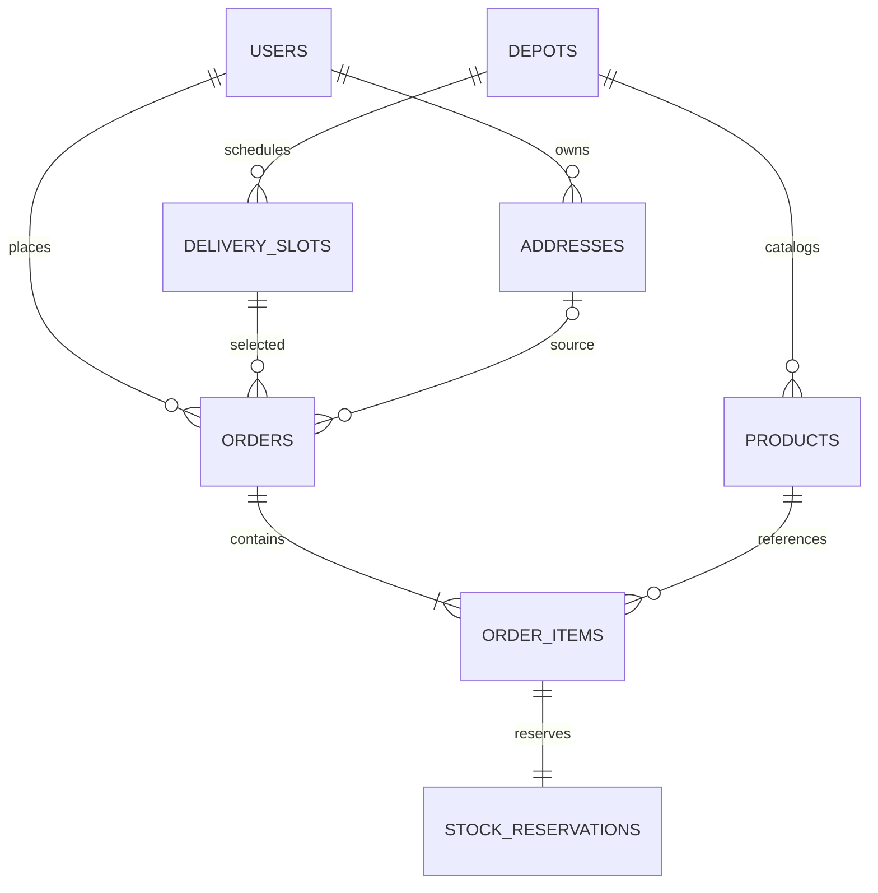
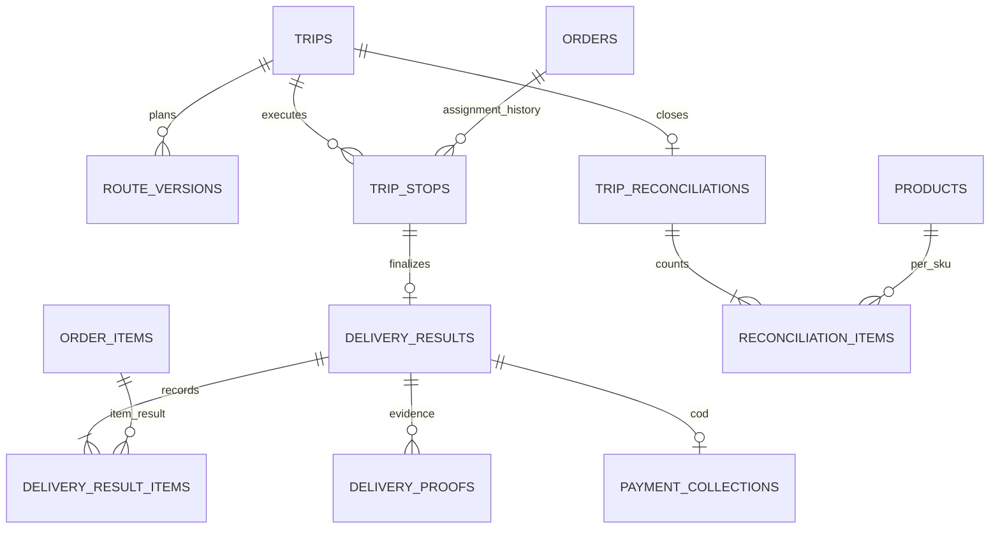

# ERD — ShipX

Checkpoint 13 November 2026 menambah product_favorites dengan primary key gabungan user_id/product_id, foreign key ke users/products serta timestamps. Favorit bersifat per customer. Frekuensi pemesanan dihitung dari orders/order_items milik customer yang mengakses. Migration000012 telah diterapkan.

Checkpoint 8 November 2026: migration 000010 sudah Ran, menambah trip_reconciliations (trip UNIQUE, expected/actual cash, signed difference, reason, approved_by/at, inventory_transaction_id UNIQUE) dan reconciliation_items (FK receipt/product, state, expected/actual quantity, signed difference, reason, UNIQUE receipt/product/state). Rekonsiliasi final mengosongkan akun trip, mengkredit barang aktual ke depot sesuai kondisi, mencatat ledger/audit dan completed/actual_return_at serta melepas claims atomik. Collection/order final tidak diubah. Detail ada di RECONCILIATION_CHECKPOINT.md; status belum tersedia di bawah merupakan histori.

Versi 0.2 · mengacu PRD_ShipX.md. Menggantikan model khusus galon. Users (phone, role, is_active) dan personal_access_tokens Sanctum sudah dimigrasi pada MySQL lokal 4 November 2026; tabel domain lain masih rancangan. Phone nullable untuk kompatibilitas user lama, wajib pada register baru. Seluruh implementasi baru mengikuti dokumen aktif ini, bukan docs/history.

## Relasi inti

Checkpoint 6 November 2026 mengimplementasikan delivery_results, delivery_result_items, delivery_proofs dan payment_collections sesuai bagian pengiriman/COD. Migration 000009 menambah delivery_proof_uploads UUID dengan actor/stop/upload-key unik, MIME/size/hash/storage/status/expiry. Result order/stop memakai composite FK, bukti/upload dan payment per result unik. Pencatatan mengubah ledger/order/trip atomik. Staging file di luar transaksi dengan cleanup expired, bukti attached dipertahankan. Rekonsiliasi belum diimplementasikan. Lihat DELIVERY_RESULTS_CHECKPOINT.md.

Checkpoint keberangkatan 5 November 2026: migration 000008 Ran. inventory_accounts dan inventory_transactions memiliki nullable trip_id FK; owner_key depot/trip:{id} dijaga service. trip_departure_reviews menyimpan trip/route FK, trip_version, source manual_road_estimate, source_reference, leg_seconds JSON, schedule_snapshot JSON, master_versions JSON, reviewed_by, reason, handling_checked, reviewed_at/expires_at; append-only, UNIQUE(trip_id,id). trip_load_confirmations PK trip_id menyimpan courier_id, route_version_id (composite trip/route FK), departure_review_id (composite trip/review FK), inventory_transaction_id UNIQUE, manifest/departure_schedule JSON dan confirmed_at. loaded_* serta actual_departure_at trips terisi saat start. StockReservation consumed_at dipakai; load ledger satu event_key per trip. Hasil, COD dan rekonsiliasi tetap rancangan. Detail: TRIP_DEPARTURES_CHECKPOINT.md.

Checkpoint trip manual: migration `2026_11_04_000007_create_manual_trips` sudah Ran. trips, route_versions, trip_stops, active_order_allocations, courier_trip_locks, vehicle_trip_locks dan trip_events sudah tersedia, termasuk composite FK sesuai bagian integritas di bawah. trips menambah timezone_snapshot, planned_weight_g/planned_volume_cm3, loaded_* default 0. Snapshot rute manual memiliki feasibility_status=not_evaluated; ETA stops nullable. Events append-only menyimpan actor_id/action/reason/trip_version/created_at UTC. Dispatch/stock trip/results/COD/reconciliation belum dibuat. Detail implementasi dan uji: MANUAL_TRIPS_CHECKPOINT.md. Pernyataan trip/claim belum ada pada checkpoint sebelumnya merupakan histori.

Checkpoint master armada: migration `2026_11_04_000006_create_fleet_masters` sudah Ran. Users memiliki lock_version integer default 0 untuk edit kurir dengan versi. Vehicles sudah diimplementasikan sesuai tabel master di bawah; name/plate_number/lock_version ditambahkan untuk operasi admin, unique pelat per depot. Belum ada tabel trip/claim kendaraan/kurir; proteksi penugasan ganda menyusul pada trip manual.

Checkpoint keputusan admin: migration `2026_11_04_000005_create_order_decisions` sudah Ran. order_decisions(order_id UNIQUE FK orders, admin_id FK users, decision confirmed/rejected, reason nullable max500, order_version, decided_at, timestamps) mencatat satu keputusan admin per order. confirmed_at pada orders kini digunakan dan dicast datetime; penolakan memakai closed_at/status_reason. Catatan keputusan tidak diedit lewat aplikasi. Belum ada tabel trip atau audit generik; catatan historis di bawah yang menyebut konfirmasi belum aktif telah digantikan.

Checkpoint stok/checkout: migration `2026_11_04_000004_create_inventory_and_orders` telah menambahkan inventory_accounts, inventory_transactions/entries, orders/items, stock_reservations dan idempotency_records. Saat ini account hanya owner_key=depot (available/quarantine); trip_id/FK trip, reversal dan audit generik ditambahkan pada fase pengiriman. Transaksi memiliki actor, reason, event_key unik dan occurred_at; API tidak menyediakan edit/hapus entry ledger. Saldo awal nol tidak membuat entry. Order menyimpan timezone_snapshot tambahan untuk tampilan jadwal historis. Kolom biaya/berat/volume memakai unsigned BIGINT. Konfirmasi/admin delivery belum aktif; status yang dihasilkan tahap ini pending/cancelled.

Checkpoint delivery (4 November 2026): migration `000003_create_delivery_settings_addresses_slots` menambahkan kolom depot sesuai master, serta addresses dan delivery_slots. Lokasi/radius/ongkir depot nullable selama belum dikonfigurasi. Default zona Asia/Jakarta, TTL 30 menit, layanan 300 detik. Depot, alamat dan slot memiliki lock_version; address dinonaktifkan, tidak dihapus melalui API. FK user/depot RESTRICT. Slot menyimpan service_date lokal depot dan seluruh datetime UTC. Zona waktu depot dikunci setelah ada slot. Stock/order belum dimigrasi.

Status checkpoint katalog (4 November 2026): tabel `products` sudah dibuat dengan field sesuai master, ditambah `lock_version` untuk mencegah edit bersamaan saling menimpa. Tabel `depots` sementara berisi id/name/timestamps dan satu identitas `Depot utama`; field lokasi, radius dan konfigurasi delivery masih rancangan, akan ditambahkan saat alamat/slot. Volume produk dihitung server dari bounding box kemasan dengan pembulatan ke atas. Tidak ada seed produk bisnis atau stok fiktif.

## Master dan pemesanan

Semua PK/FK BIGINT UNSIGNED; uang integer rupiah; kuantitas integer; waktu UTC; koordinat DECIMAL(10,7). Tabel mutable punya updated_at/lock_version jika menerima update bersamaan, semua tabel punya created_at. FK bisnis RESTRICT; jangan cascade-delete histori.

| Tabel | Kolom utama dan aturan |
| --- | --- |
| users | id, name, email UNIQUE, password, phone, role(customer/courier/admin), is_active |
| addresses | id, user_id FK, label, recipient_name, phone, address_text, latitude, longitude, directions?, is_active |
| depots | id, name, address_text, latitude, longitude, timezone, service_radius_m, delivery_fee_rp, pending_ttl_minutes, default_service_seconds |
| products | id, depot_id FK, sku, name, category, unit_label, unit_price_rp, shipping_weight_g, shipping_volume_cm3, length_mm, width_mm, height_mm, handling_notes?, is_active; UNIQUE(depot_id, sku) |
| delivery_slots | id, depot_id FK, service_date, window_start_at, window_end_at, cutoff_at, is_active; UNIQUE(depot_id, window_start_at, window_end_at) |
| orders | id, order_number UNIQUE, depot_id FK, customer_id FK, source_address_id? FK, delivery_slot_id FK, rescheduled_from_order_id? FK, status, payment_status, recipient_name, recipient_phone, address_text, latitude, longitude, directions?, window_start_at, window_end_at, subtotal_rp, delivery_fee_rp, total_rp, total_weight_g, total_volume_cm3, pending_expires_at, confirmed_at?, cancelled_at?, closed_at?, status_reason?, lock_version |
| order_items | id, order_id FK, product_id FK, product_name_snapshot, unit_label_snapshot, quantity, unit_price_rp, line_total_rp, unit_weight_g, unit_volume_cm3, length_mm_snapshot, width_mm_snapshot, height_mm_snapshot, handling_notes_snapshot?; UNIQUE(order_id, product_id) |
| stock_reservations | id, order_item_id FK UNIQUE, inventory_account_id FK, quantity, status(active/released/consumed), released_at?, consumed_at? |

Shipping metadata merepresentasikan kemasan per unit jual. Semua dimensi/berat/volume positif; ukuran SKU harus dicatat sebelum dijual. volume kemasan tidak boleh kurang dari bounding box length×width×height dalam cm³, konversi mm³ / 1000 dengan pembulatan ke atas. Server menghitung dan memvalidasi metadata, bukan menerima total dari client. Index orders(customer_id, created_at), orders(depot_id,status,window_start_at), orders(status,pending_expires_at), reservations(inventory_account_id,status).

## Perjalanan dan hasil

| Tabel | Kolom utama dan aturan |
| --- | --- |
| vehicles | id, depot_id FK, code, name, plate_number, travel_mode(motorcycle/car), max_load_weight_g, max_load_volume_cm3, is_active, lock_version, timestamps; UNIQUE(depot_id,code), UNIQUE(depot_id,plate_number) |
| trips | id, trip_number UNIQUE, depot_id FK, courier_id? FK users, vehicle_id? FK, status, planned_departure_at, actual_departure_at?, actual_return_at?, capacity_weight_g_snapshot?, capacity_volume_cm3_snapshot?, loaded_weight_g, loaded_volume_cm3, selected_route_version_id?, created_by FK, lock_version |
| route_versions | id, trip_id FK, version_number, source, algorithm_version?, feasibility_status, input_snapshot JSON, baseline_snapshot JSON, proposed_snapshot JSON, selected_snapshot JSON, provider_name?, matrix_fetched_at?, calculation_duration_ms?, reviewed_by? FK, reviewed_at?, review_reason?, created_by FK; UNIQUE(trip_id,version_number) |
| trip_stops | id, trip_id FK, order_id FK, route_version_id FK, sequence_no, status, estimated_arrival_at, estimated_service_start_at, planned_service_seconds, arrived_at?, voided_at?, void_reason?; UNIQUE(trip_id,route_version_id,sequence_no), UNIQUE(trip_id,route_version_id,order_id) |
| delivery_results | id, trip_stop_id FK UNIQUE, order_id FK UNIQUE, recorded_by FK, outcome(delivered/failed), failure_reason?, notes?, occurred_at, recorded_at |
| delivery_result_items | id, delivery_result_id FK, order_item_id FK, delivered_quantity; UNIQUE(delivery_result_id,order_item_id) |
| delivery_proofs | id, delivery_result_id FK, storage_key UNIQUE, mime_type, file_size_bytes, checksum_sha256, captured_at?, uploaded_by FK |

Setiap result memiliki baris untuk semua item order: delivered berarti setiap quantity sesuai order; failed berarti semuanya nol dan alasan wajib. Tidak ada empty_received_quantity atau asumsi tukar wadah. Validasi bahwa result item berasal dari order yang sama dilakukan service sambil lock order. Tidak menerima product_id bebas sebagai pengganti order_item_id.

Draft route menyimpan kandidat JSON. Penetapan membuat trip_stops dan active claims atomik. Versi lama di-void saat perencanaan ulang sebelum keberangkatan, tidak dihapus. Setelah berangkat rute dikunci. snapshot input mencakup berat/volume item, kapasitas, lokasi, jendela, keberangkatan dan durasi layanan; tidak menyimpan secret provider.

## Alokasi aktif dan konsistensi relasi

- active_order_allocations(order_id PK/FK, trip_id FK, trip_stop_id FK UNIQUE).
- courier_trip_locks(courier_id PK/FK users, trip_id FK UNIQUE).
- vehicle_trip_locks(vehicle_id PK/FK, trip_id FK UNIQUE).
- Claim/lock dilepas setelah cancelled sebelum berangkat atau completed sesudah rekonsiliasi. Histori tetap pada domain dan audit.
- route_versions UNIQUE(trip_id,id); trips(id,selected_route_version_id) composite FK → route_versions(trip_id,id), ditambahkan setelah dua tabel ada.
- trip_stops(trip_id,route_version_id) composite FK → route_versions(trip_id,id).
- trip_stops UNIQUE(order_id,trip_id,id); claim(order_id,trip_id,trip_stop_id) composite FK → stop(order_id,trip_id,id).
- trip_stops UNIQUE(order_id,id); result(order_id,trip_stop_id) composite FK → stop(order_id,id).
- Service memvalidasi depot sama, role kurir sesuai, status valid dan kapasitas kedua dimensi terpenuhi; FK saja tidak cukup.

## Ledger stok generik

inventory_accounts: id, depot_id FK, trip_id? FK, product_id FK, stock_state(available/quarantine), owner_key, balance_quantity, lock_version. UNIQUE(depot_id,owner_key,product_id,stock_state). owner_key=`depot` jika trip_id NULL atau `trip:{id}` jika ada; validasi kesesuaian dengan CHECK/service. Saldo integer nonnegatif.

inventory_transactions: id, event_key UNIQUE, kind(opening/load/delivery/return/adjustment/reversal), order_id? FK, trip_id? FK, reversal_of_id? FK, reason?, created_by FK, occurred_at.

inventory_entries: id, inventory_transaction_id FK, inventory_account_id FK, quantity_delta signed nonzero; UNIQUE(transaction_id,account_id) dengan nama kolom inventory_transaction_id. Semua saldo diubah bersamaan dengan entry, tidak diedit bebas.

| Kejadian per SKU | Pergerakan |
| --- | --- |
| Muat q | depot/available −q; trip/available +q; reservation consumed |
| Delivered q | trip/available −q; barang keluar ke pelanggan |
| Failed | Tidak ada mutasi, stok tetap di trip |
| Return q | trip/available −q; depot/available +q |
| Rusak | trip/available −q; trip/quarantine +q; alasan wajib |

Tidak ada stock_state full/empty, transaksi refill, atau akun wadah generik. Mutasi delivery adalah arus keluar ke pelanggan; bukan transfer internal yang harus berjumlah nol. Transfer internal per SKU harus seimbang. Koreksi menggunakan adjustment/compensation yang dapat diaudit. Saat completed seluruh saldo account trip termasuk quarantine harus nol.

## COD dan rekonsiliasi per SKU

- payment_collections: id, delivery_result_id FK UNIQUE, collected_by FK, amount_rp, method(cash), collected_at. Hanya untuk delivered, amount sama dengan tagihan order.
- trip_reconciliations: id, trip_id FK UNIQUE, expected_cash_rp, actual_cash_rp, cash_difference_rp signed, discrepancy_reason?, approved_by FK, approved_at.
- reconciliation_items: id, trip_reconciliation_id FK, product_id FK, stock_state, expected_quantity, actual_quantity, difference signed, discrepancy_reason?; UNIQUE(trip_reconciliation_id,product_id,stock_state).
- Selisih actual−expected, dihitung server. Per SKU/kondisi dibuat baris expected/actual, termasuk SKU yang muncul secara fisik meskipun expected nol. Selisih barang/uang wajib alasan; admin menyetujui satu rekonsiliasi final. Koreksi tidak mengubah collection lama untuk memaksa angka cocok.

## Request ulang, audit dan implementasi

audit_logs: actor_id?, action, entity_type/id, before/after JSON?, reason?, request_id?; append-only, redact credential. idempotency_records: user_id FK, operation, idempotency_key, request_hash, status, response_code/body?, expires_at; UNIQUE(user_id,operation,idempotency_key). Transaksi penting memakai idempotency serta domain UNIQUE event/result.

Lock seluruh inventory accounts SKU secara ID ascending, orders ascending, lalu trip; semua jalur mutation memakai urutan sama. Revalidasi versi/status setelah lock, rollback seluruh order bila satu SKU tidak tersedia. Provider API/upload file di luar transaksi database. Perubahan status delivered, result items, ledger dan COD berada dalam satu transaksi.

Urutan migration: master → order/items → trips → route_versions dan FK terpilih → stops/claims/locks → accounts/reservations/ledger → results/items/proofs → collections/reconciliations/items → audit/idempotency. Migration masih harus dibuat dan diuji di MySQL, termasuk transaksi multi-SKU dan race conditions.
