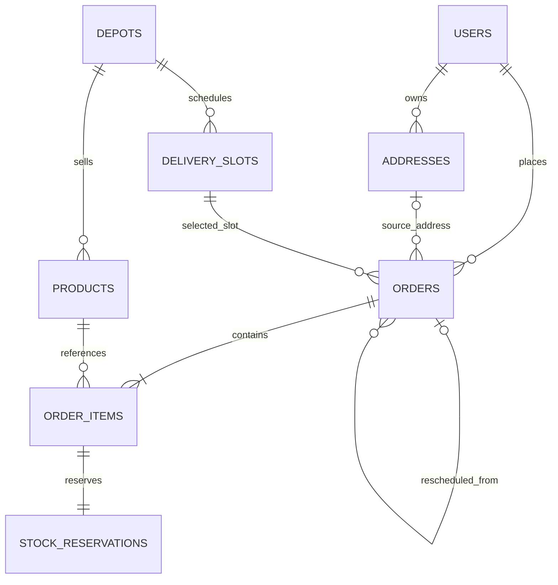
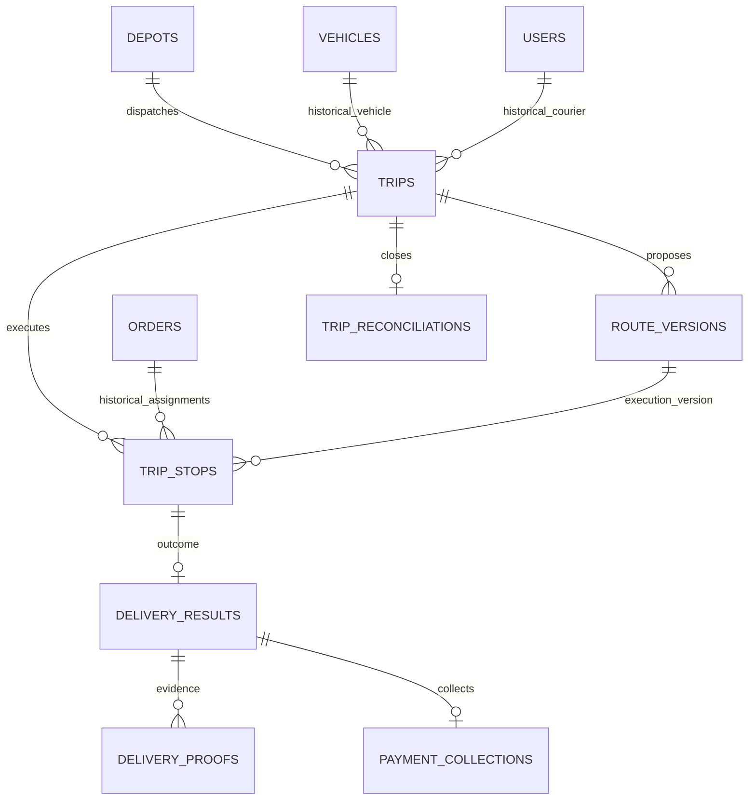
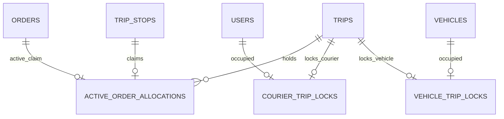
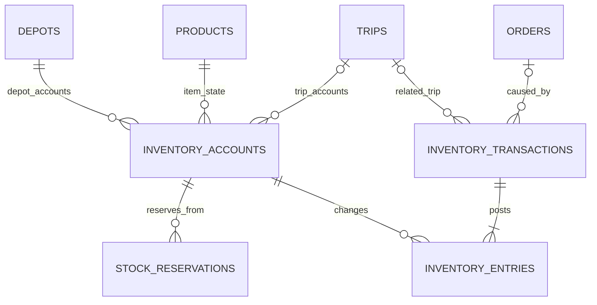

> HISTORIS v0.1 — aturan khusus galon dalam dokumen ini sudah digantikan oleh PRD_ShipX.md, ERD_ShipX.md, dan API_PHASE_1.md aktif. Jangan implementasikan aturan lama.

# ERD ShipX — rancangan database MVP

Versi 0.1 · 4 November 2026  
Acuan: PRD_ShipX.md versi 0.1. Dokumen desain, belum berupa migration yang dijalankan.

## 1. Prinsip desain

- Satu depot, satu produk galon, tukar wadah 1:1, COD, penyerahan seluruh pesanan atau gagal seluruhnya.
- Satu tabel users untuk customer/courier/admin. Role disimpan sebagai nilai terbatas, bukan tabel permission generik.
- Alamat, tarif, dan jendela layanan disalin ke orders agar riwayat tidak berubah saat master diedit.
- Stok fisik dipisahkan dari reservasi. Stok perjalanan dipisahkan dari stok depot sampai rekonsiliasi selesai.
- Riwayat rencana berbeda dari pelaksanaan: route_versions menyimpan usulan, trip_stops menyimpan tujuan eksekusi.
- Penugasan aktif memiliki constraint database tersendiri agar dua admin tidak mengalokasikan pesanan atau kendaraan yang sama.
- Tabel pendukung hanya dipakai untuk menjaga stok, transaksi, histori, serta request ulang; tidak menambahkan fitur bisnis di luar PRD.

## 2. ERD inti pemesanan

Cardinality menunjukkan aturan bisnis setelah transaksi lengkap; FK sendiri tidak menjamin induk selalu mempunyai anak. Notasi `o|` berarti referensi opsional, `o{` berarti nol atau lebih.

## 3. ERD perjalanan dan hasil pengiriman

Satu order boleh punya beberapa trip_stops historis akibat pembatalan penugasan sebelum berangkat, tetapi hanya satu penugasan aktif dan satu hasil final. MVP tidak melakukan retry pada order yang sudah failed; buat order baru yang merujuk order asal.

## 4. ERD pencegahan alokasi ganda

Tiga tabel kecil ini menyatakan kepemilikan aktif, bukan riwayat. Baris boleh dihapus saat dilepas; riwayat tetap pada trips, trip_stops dan audit_logs. Hindari UNIQUE(order_id, is_active): pola itu juga membatasi jumlah baris historis inactive.

## 5. ERD stok

Accounts adalah saldo barang per lokasi dan kondisi: depot/full, depot/empty, depot/quarantine; serta tiga akun serupa untuk setiap perjalanan. Account perjalanan mewakili barang yang menjadi tanggung jawab perjalanan tersebut. Vehicle tidak dijadikan sumber saldo agar riwayat perjalanan tidak tercampur.

## 6. Konvensi kolom

- PK `id`: BIGINT UNSIGNED auto increment. Nomor order/trip adalah kode publik unik; otorisasi tetap wajib.
- FK menggunakan BIGINT UNSIGNED. Semua FK default RESTRICT untuk penghapusan data bisnis.
- Setiap tabel memiliki created_at; tabel mutable juga updated_at. Timestamp bisnis UTC dengan presisi mikrodetik bila tersedia; tampilan Asia/Jakarta.
- Uang: BIGINT integer rupiah, bukan float. Selisih uang bertipe signed.
- Kuantitas: INT nonnegatif; delta stok: INT signed.
- Koordinat: latitude DECIMAL(10,7), longitude DECIMAL(10,7); rentang −90..90 dan −180..180.
- Status: VARCHAR dengan domain tervalidasi dan CHECK pada migration untuk versi MySQL yang dikunci. Jangan mengandalkan validasi UI.
- `?` berarti nullable. Kolom JSON hanya untuk snapshot/metadata, bukan relasi operasional yang membutuhkan FK.
- Foto disimpan sebagai file privat; database hanya menyimpan storage key dan metadata.

## 7. Kamus tabel — akun dan master

| Tabel | Kolom utama | Constraint / indeks penting |
| --- | --- | --- |
| users | id, name, email, email_verified_at?, password, phone, role, is_active | UNIQUE(email); role customer/courier/admin; nomor HP belum menjadi identitas login |
| addresses | id, user_id, label, recipient_name, phone, address_text, latitude, longitude, directions?, is_active | FK user; INDEX(user_id, is_active); alamat tidak dihapus fisik setelah dipakai |
| depots | id, name, address_text, latitude, longitude, timezone, service_radius_m, delivery_fee_rp, pending_ttl_minutes, default_service_seconds, is_active | Radius/TTL/durasi positif; MVP men-seed satu depot |
| products | id, depot_id, sku, name, refill_price_rp, is_active | UNIQUE(depot_id, sku); harga nonnegatif; hanya satu produk aktif untuk MVP |
| delivery_slots | id, depot_id, service_date, window_start_at, window_end_at, cutoff_at, is_active | UNIQUE(depot_id, window_start_at, window_end_at); start < end; cutoff <= start; INDEX(depot_id, service_date) |
| vehicles | id, depot_id, code, plate_number?, travel_mode, capacity_units, is_active | UNIQUE(depot_id, code); capacity > 0; travel_mode harus didukung/ditinjau untuk provider rute |

Slot adalah kejadian konkret pada tanggal tertentu, bukan template hari mingguan. Kapasitas slot belum dijanjikan sebagai kuota otomatis; admin menentukan kelayakan gelombang dari armada dan jendela layanan.

## 8. Kamus tabel — pesanan

| Tabel | Kolom utama | Constraint / indeks penting |
| --- | --- | --- |
| orders | id, order_number, depot_id, customer_id, source_address_id?, delivery_slot_id, rescheduled_from_order_id?, status, payment_status, recipient_name, recipient_phone, address_text, latitude, longitude, directions?, window_start_at, window_end_at, subtotal_rp, delivery_fee_rp, total_rp, pending_expires_at, confirmed_at?, cancelled_at?, closed_at?, status_reason?, lock_version | UNIQUE(order_number); INDEX(depot_id, status, window_start_at); INDEX(customer_id, created_at); INDEX(status, pending_expires_at); subtotal + fee = total |
| order_items | id, order_id, product_id, product_name_snapshot, quantity, unit_price_rp, line_total_rp | UNIQUE(order_id, product_id); quantity > 0; line_total = quantity × unit_price |
| stock_reservations | id, order_item_id, inventory_account_id, quantity, status, released_at?, consumed_at? | UNIQUE(order_item_id); INDEX(inventory_account_id, status); quantity > 0; status active/released/consumed |

Domain orders.status: pending, confirmed, assigned, out_for_delivery, delivered, failed, rejected, cancelled. Domain payment_status: unpaid, collected, reconciled. Pembatalan otomatis pending memakai cancelled dengan reason pending_expired.

Server menyalin harga, alamat, dan jendela saat order dibuat. Relasi source_address_id hanya menunjukkan asal; proses pengiriman selalu memakai snapshot. Nilai `pending_expires_at` hanya berlaku saat status pending; confirmed tidak kedaluwarsa melalui job pending.

Reservation dibuat satu per item, aktif sampai dilepas atau dikonsumsi saat pemuatan. Untuk retry failed, order baru mendapat reservation baru. MVP satu produk tidak membutuhkan pesanan dengan banyak jenis barang, tetapi order_items menjaga rincian harga tanpa mencampurnya dengan header pesanan.

## 9. Kamus tabel — perencanaan dan eksekusi

| Tabel | Kolom utama | Constraint / indeks penting |
| --- | --- | --- |
| trips | id, trip_number, depot_id, courier_id?, vehicle_id?, status, planned_departure_at, actual_departure_at?, actual_return_at?, capacity_units_snapshot?, loaded_units, selected_route_version_id?, planned_distance_m?, planned_duration_s?, assigned_at?, completed_at?, created_by, lock_version | UNIQUE(trip_number); INDEX(depot_id, status, planned_departure_at); courier/vehicle wajib mulai assigned |
| route_versions | id, trip_id, version_number, source, algorithm_version?, feasibility_status, input_snapshot, baseline_snapshot, proposed_snapshot, selected_snapshot, selected_distance_m?, selected_duration_s?, provider_name?, vehicle_mode?, matrix_fetched_at?, calculation_duration_ms?, reviewed_by?, reviewed_at?, review_reason?, created_by | UNIQUE(trip_id, version_number); source heuristic/manual; feasible/infeasible/provider_error; snapshot immutable setelah disimpan |
| trip_stops | id, trip_id, order_id, route_version_id, sequence_no, status, estimated_arrival_at, estimated_service_start_at, planned_service_seconds, arrived_at?, voided_at?, void_reason? | UNIQUE(trip_id, route_version_id, sequence_no); UNIQUE(trip_id, route_version_id, order_id); INDEX(order_id); status planned/delivered/failed/voided |
| active_order_allocations | order_id PK, trip_stop_id, trip_id | FK ketiganya; UNIQUE(trip_stop_id); satu order hanya diklaim satu rencana aktif |
| courier_trip_locks | courier_id PK, trip_id | FK users/trips; UNIQUE(trip_id) |
| vehicle_trip_locks | vehicle_id PK, trip_id | FK vehicles/trips; UNIQUE(trip_id) |
| delivery_results | id, trip_stop_id, order_id, recorded_by, outcome, delivered_quantity, empty_received_quantity, failure_reason?, notes?, occurred_at, recorded_at | UNIQUE(trip_stop_id); UNIQUE(order_id); outcome delivered/failed |
| delivery_proofs | id, delivery_result_id, storage_key, mime_type, file_size_bytes, checksum_sha256, captured_at?, uploaded_by | INDEX(delivery_result_id); UNIQUE(storage_key) |

trips.status: draft, assigned, in_progress, awaiting_reconciliation, completed, cancelled. trips memuat histori kurir/kendaraan yang ditetapkan, sehingga tabel courier_assignments terpisah dari konsep PRD tidak diperlukan pada MVP. Perubahan sebelum keberangkatan dicatat audit dan lock diperbarui atomik.

### Isi snapshot rute

input_snapshot memuat ID order dan koordinat, node depot awal/akhir, jumlah, jendela, layanan, kapasitas serta keberangkatan. baseline/proposed/selected masing-masing memuat urutan order ID, durasi perjalanan/layanan/tunggu, jarak, ETA tiap stop dan konflik. Jangan menyimpan profil pelanggan berlebih atau secret provider.

Baseline dan kandidat dihitung dari input/matriks yang sama. Jika baseline tidak layak, persentase penghematan tidak ditampilkan. Penyimpanan matriks/provider response mengikuti lisensi provider: matriks tidak wajib dipersistenkan; simpan metadata dan hasil yang diizinkan, jangan mengasumsikan hak penyimpanan tanpa batas.

### Integritas versi dan alokasi

- Draft menyimpan kandidat pada snapshot; trip_stops dan claims baru dibuat saat admin menetapkan versi yang dipilih.
- Mengganti versi sebelum berangkat men-void stop lama, melepas claims, membuat stop baru, dan memasang claims dalam satu transaksi.
- selected_route_version_id harus merujuk versi dari trip yang sama. Tambahkan UNIQUE(trip_id, id) pada route_versions dan composite FK trips(id, selected_route_version_id) → route_versions(trip_id, id) setelah kedua tabel dibuat.
- Tambahkan UNIQUE(trip_id, id) pada trip_stops dan composite FK trip_stops(trip_id, route_version_id) → route_versions(trip_id, id).
- Agar claim tidak menunjuk order/trip yang salah, tambahkan UNIQUE(order_id, trip_id, id) pada trip_stops dan composite FK active_order_allocations(order_id, trip_id, trip_stop_id) → trip_stops(order_id, trip_id, id).
- Agar hasil tidak menunjuk order yang berbeda, tambahkan UNIQUE(order_id, id) pada trip_stops dan composite FK delivery_results(order_id, trip_stop_id) → trip_stops(order_id, id).
- Semua perubahan rute ditolak setelah in_progress. API kurir harus mengirim versi perjalanan yang terakhir diterima.

Lock kurir/kendaraan dipasang saat assigned dan baru dilepas ketika completed/cancelled. Mempertahankan lock pada awaiting_reconciliation adalah pengetatan MVP: kendaraan tidak ditugaskan lagi sebelum muatan lama selesai dihitung. Claim order dipertahankan sampai perjalanan ditutup agar hasil gagal belum bisa dijadwal ulang sebelum barang direkonsiliasi.

## 10. Kamus tabel — inventory ledger

| Tabel | Kolom utama | Constraint / indeks penting |
| --- | --- | --- |
| inventory_accounts | id, depot_id, trip_id?, product_id, stock_state, owner_key, balance_quantity, lock_version | UNIQUE(depot_id, owner_key, product_id, stock_state); balance >= 0; state full/empty/quarantine |
| inventory_transactions | id, event_key, kind, order_id?, trip_id?, reversal_of_id?, reason?, created_by, occurred_at | UNIQUE(event_key); kind opening/load/delivery/return/refill/adjustment/reversal; INDEX(trip_id, occurred_at) |
| inventory_entries | id, inventory_transaction_id, inventory_account_id, quantity_delta | delta != 0; INDEX(inventory_account_id, id); UNIQUE(inventory_transaction_id, inventory_account_id) |

owner_key adalah nilai server `depot` atau `trip:{id}`. CHECK mewajibkan depot→trip_id NULL, trip:{id}→trip_id sesuai. FK trip harus berada di depot yang sama. Pendekatan ini menghindari celah UNIQUE dengan nullable trip_id di MySQL. Nilai key tidak dapat diisi bebas oleh client.

Saldo adalah cache operasional yang diperbarui bersamaan dengan entries, bukan nilai yang boleh diedit langsung. Reservation dijumlah dari tabel stock_reservations aktif dengan account yang sama. Semua pembuat/pelepas reservation wajib mengunci account terlebih dahulu agar perhitungan available tetap aman.

| Kejadian | Entri ledger |
| --- | --- |
| Muat 10 | depot/full −10; trip/full +10; reservation terkait menjadi consumed |
| Antar 2, tukar 2 | trip/full −2; trip/empty +2; order delivered dan COD ditulis dalam transaksi yang sama |
| Gagal antar | Tidak ada mutasi; galon tetap trip/full |
| Kembali 3 penuh + 7 kosong | trip/full −3; depot/full +3; trip/empty −7; depot/empty +7 |
| Isi ulang 7 | depot/empty −7; depot/full +7 |
| Bocor 1 | trip/full −1; trip/quarantine +1; alasan wajib |

Ledger mencatat satuan wadah yang berubah kondisi, bukan akuntansi uang. Opening/adjustment dapat menambah/mengurangi total wadah dengan alasan. Kejadian internal transfer/refill wajib seimbang jumlah unit, diperiksa service. Koreksi menggunakan transaksi kompensasi; riwayat tidak diubah/dihapus.

Jika expected trip/full 3 tetapi fisik hanya 2, lakukan adjustment trip/full −1 dengan alasan dan persetujuan, lalu return 2. Jangan mengembalikan 3 lalu diam-diam mengurangi depot. Pada completed semua saldo akun trip harus nol setelah return/adjustment termasuk karantina.

## 11. COD dan rekonsiliasi

| Tabel | Kolom utama | Constraint / indeks penting |
| --- | --- | --- |
| payment_collections | id, delivery_result_id, collected_by, amount_rp, method, collected_at | UNIQUE(delivery_result_id); amount > 0; method cash |
| trip_reconciliations | id, trip_id, expected_full_units, actual_full_units, expected_empty_units, actual_empty_units, expected_quarantine_units, actual_quarantine_units, expected_cash_rp, actual_cash_rp, full_difference, empty_difference, quarantine_difference, cash_difference_rp, discrepancy_reason?, approved_by, approved_at | UNIQUE(trip_id); difference = actual − expected; alasan wajib jika ada selisih |

MVP membuat satu reconciliation final per trip. Form yang belum disetujui tidak mem-posting perubahan. expected dihitung server dari ledger serta payment_collections, bukan dipercaya dari request client. Bukti hitungan final disimpan immutable; koreksi setelah penutupan lewat adjustment/audit terotorisasi, tidak mengganti bukti persetujuan lama.

payment_collections hanya ada untuk hasil delivered dengan amount sama dengan orders.total_rp. Hasil failed punya delivered_quantity=0, empty_received_quantity=0, alasan wajib dan tidak punya penerimaan COD. Delivered mewajibkan kedua quantity sama dengan jumlah item order, bukti minimal satu, dan payment collection. Persyaratan lintas tabel ini diperiksa service dalam satu transaksi.

Status payment orders berpindah unpaid→collected saat hasil delivered; collected→reconciled saat admin menyetujui perhitungan uang. Bila ada selisih, approval merekam selisih serta alasan, bukan mengubah collection asli agar terlihat cocok.

## 12. Pendukung keamanan transaksi

| Tabel | Kolom utama | Constraint / indeks penting |
| --- | --- | --- |
| audit_logs | id, actor_id?, action, entity_type, entity_id, before_data?, after_data?, reason?, request_id?, created_at | INDEX(entity_type, entity_id, created_at); append-only; redact password/token dan data sensitif berlebih |
| idempotency_records | id, user_id, operation, idempotency_key, request_hash, status, response_code?, response_body?, expires_at | UNIQUE(user_id, operation, idempotency_key); INDEX(expires_at); key sama dengan payload beda → conflict |

Identitas entity pada audit adalah referensi polymorphic untuk pencatatan, tidak dipakai sebagai pengganti FK stok/pembayaran. Framework tables seperti personal_access_tokens, jobs, failed_jobs, sessions dan password_reset_tokens mengikuti kebutuhan Laravel, tidak digambar sebagai domain bisnis.

## 13. Batas database dan service

| Aturan | Penjagaan |
| --- | --- |
| Satu order tidak masuk dua rute aktif | PK active_order_allocations.order_id |
| Satu kurir/kendaraan tidak dipakai dua trip aktif | PK courier_trip_locks.courier_id dan vehicle_trip_locks.vehicle_id |
| Hasil dan COD tidak tercatat dua kali | UNIQUE delivery_results.order_id / trip_stop_id dan payment_collections.delivery_result_id |
| Satu mutasi bisnis tidak diposting dua kali | UNIQUE inventory_transactions.event_key |
| Stok tidak dijanjikan melebihi tersedia | Transaksi, lock account, hitung reservation aktif, validasi stok |
| Muatan <= kapasitas | Service saat penetapan dan keberangkatan, dengan snapshot kapasitas |
| Role kurir/admin dan depot sesuai | Policy/service; FK users saja tidak membuktikan role |
| Harga/jumlah/status valid | CHECK lokal + service untuk perhitungan lintas tabel dan transisi |
| Mutasi dan cached balance cocok | Satu transaksi penulisan; pemeriksaan ledger berkala |

Gunakan urutan lock konsisten: inventory account ID ascending, lalu order ID ascending, lalu trip. Operasi pembatalan/finalisasi harus mengikuti urutan global yang sama; resource claim disisipkan setelah row domain dikunci. Tangani deadlock dengan retry terbatas. Jangan memanggil routing API atau mengunggah file selama memegang lock database.

## 14. Urutan transaksi penting

### Checkout

Validasi identitas/alamat/slot → klaim idempotency key → lock akun depot/full → cek saldo dikurangi reservasi → buat order/item/reservation/snapshot → simpan response → commit. Semua perubahan harus rollback bila salah satu gagal.

### Penetapan rute

Hitung kandidat di luar transaksi → mulai transaksi → lock accounts/orders/trip secara konsisten → periksa input belum berubah serta versi cocok → void penugasan lama bila ada → buat stop/claims/lock resources → pilih route version → update order assigned → commit. Konflik claim membatalkan transaksi seluruhnya; rencana dihitung ulang bila data berubah.

### Berangkat

Klaim idempotency → lock accounts/orders/trip → cek assigned, versi, stok serta kapasitas → ledger load dan konsumsi reservation → order out_for_delivery → trip in_progress dan actual_departure_at → commit.

### Hasil pengantaran

Upload bukti ke lokasi privat sementara terlebih dahulu → klaim idempotency → lock accounts/order/trip → cek kurir, stop aktif dan status → simpan result/proof serta ledger dan collection bila berhasil → update stop/order → commit. File yatim dari rollback dibersihkan job. Callback duplikat mengembalikan hasil sebelumnya.

### Penutupan

Lock accounts/orders/trip → pastikan seluruh stop final → hitung expected di server → validasi actual/selisih dan alasan → posting adjustment/return → pastikan saldo trip nol → simpan reconciliation, ubah pembayaran collected menjadi reconciled → trip completed → lepaskan claims dan resource locks → commit.

## 15. Urutan migration

1. users; depots; addresses; products; delivery_slots; vehicles.
2. orders; order_items.
3. trips (selected_route_version_id nullable, FK ditambahkan kemudian).
4. route_versions; FK trip→selected route; trip_stops.
5. active_order_allocations; courier_trip_locks; vehicle_trip_locks.
6. inventory_accounts; stock_reservations; inventory_transactions; inventory_entries.
7. delivery_results; delivery_proofs; payment_collections; trip_reconciliations.
8. audit_logs; idempotency_records; tabel framework sesuai kebutuhan.

Rollback melepas FK selected_route_version terlebih dahulu. Nomor trip/order tidak memakai MAX(id)+1 tanpa locking. Gunakan generator kode unik dan retry saat collision.

## 16. Skenario pembuktian ERD

- Dua checkout stok terakhir; satu sukses, saldo/reservasi konsisten.
- Expiry melawan konfirmasi; hanya satu jalur status menang dan reservation tidak dilepas dua kali.
- Dua admin menetapkan order/kurir/kendaraan yang sama; satu penetapan ditolak atomik.
- Versi rute lama dikirim kurir; finalisasi ditolak sebagai stale update.
- Delivery retry setelah timeout; satu result, satu collection, satu ledger event.
- Muatan 10, berhasil 7, gagal 3; sebelum kembali trip/full=3, trip/empty=7; setelah close keduanya nol dan stok depot bertambah sesuai.
- Wadah fisik kurang satu; reconciliation menyimpan expected, actual, selisih, approval dan adjustment.
- Edit alamat/tarif/kapasitas master tidak mengubah snapshot pesanan/perjalanan yang sudah berangkat.
- Routing provider gagal atau rute infeasible tidak menghasilkan penugasan siap berangkat.

Dokumen berikutnya: kontrak API dan migration Laravel berdasarkan constraint ini. Schema belum diklaim lolos eksekusi MySQL sampai migration dibuat dan diuji.
